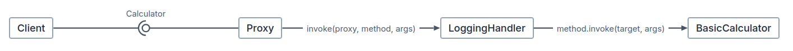
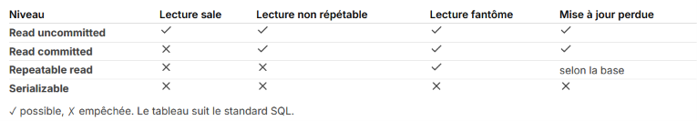

# Architecture multi tier
division par tier = division physique (différente machine)
division par couche = division logic

**Loi de conway** = En gros, si un group est fait de 3 team, bah y auras 3 partie au projet


### couche et service
couche fermé = on ne peut pas contourné
couche ouvert = on peut

- Code de spagettie quand tous les couches sont ouverts

- pour éviter les monoliths dans le cas des gros code base **→** crée une couche service

- faut faire gaff parceque service != bon code, donc on peut faire plein de service de merde

### MVC
tkt


# Fonctionnalités avancées de Java

## Class loader
En gros, c'est le service qui s'occupe de charger les class au runtime, y a une hierachie et quand on trouve pas une class demander, on monter :
Custom loader → System (classpath) → Platform (module JDK) → Bootstrap (Java)


```java
system.out.println(String.class.getClassLoader());          // null : Bootstrap, natif
System.out.println(java.sql.Driver.class.getClassLoader()); // PlatformClassLoader : module du JDK
System.out.println(Sample.class.getClassLoader());          // AppClassLoader : votre classpath
```

loader exemple :
```java
public class CustomClassLoader extends ClassLoader {

    public CustomClassLoader(ClassLoader parent) {
        super(parent);
    }

    @Override
    protected Class<?> findClass(String name) throws ClassNotFoundException {
        byte[] bytes = load(name);
        return defineClass(name, bytes, 0, bytes.length);
    }
}
```

### plugin
un plugin c'est un JAR qui est ajouter au run time en plus par le service loader

### Framework random
|spring boot | Quarkus | Fabric MC |
|---|---|---|
|truc pour faire des app<br>class loader dedier|truc pour faire du web <br> class loader hotreload|omg fabric mention|

## Reflection
relexion = programe qui se regarde lui meme

exemple :
```java
import java.lang.reflect.*;

// Instancier un objet
Class<?> clazz = Class.forName("com.example.MyClass");
Object object = clazz.getDeclaredConstructor().newInstance();

// Invoquer une méthode de l'objet
Method method = clazz.getMethod("myMethod"); // renvoie que ce qui ex plubique
method.invoke(object);
clazz.getDeclaredMethod("methodes"); // chope tous

// Affecter une valeur à un champ de l'objet
Field field = clazz.getField("myField");
field.set(object, "myValue");
clazz.getDeclaredField("methodes"); // meme vibe
```
btw la reflextion est couteuse

## Annotation au runtime

```java
@Retention(RetentionPolicy.RUNTIME) // visible par reflection à l'exécution
@Target(ElementType.FIELD)          // ne peut annoter qu'un champ
public @interface Hidden {
}
class Config {
    @Hidden String value = "???"; // annoté : à cacher
}
Config.class.getField("token").isAnnotationPresent(Hidden.class) // true
```

## Proxies
En gros, on gref une class au run time pour agire en temps que proxie a une autre genre


par logic, un proxie ça marche que s'il est sur une interface
Spring et CDI le contourne en créeant des sous-class mais du coup c'est limiter par l'héritage

aussi un proxie ne sais que choper ce qui vien de l'exterieur, pas les appel interne

## Annotation a la compilation
c'est géré par un plugin de javac. Il complie par round, il chope toutes les annotation, complie les fichiers qui les gère est continue tanqu'il y a du boulots

le but est d'éviter de recomplier chaque anotations a chaque fois en stoquand les resulta dans une fichier `target/generated-sources`

# JDBC et JPA
JDBC = API pour DB côter java

Code first = écrire les classes → deduire le schéma de la DB
Data base first = inverse de Code first

*ex de connection JDBC → lecture*
```java
// Le pilote est trouvé par ServiceLoader, s'il est sur le classpath
Connection connection = DriverManager.getConnection(
    "jdbc:postgresql://localhost:5432/postgres", "postgres", "postgres");

Statement statement = connection.createStatement();
ResultSet resultSet = statement.executeQuery("SELECT version()");

while (resultSet.next()) {
    System.out.println(resultSet.getString(1));
}
```

btw la base limite le nombre de connection, faut libéré un moment
*ex de release de connection*
```java
try (Connection connection = dataSource.getConnection();
        Statement statement = connection.createStatement();
        ResultSet resultSet = statement.executeQuery("SELECT version()")) {

    while (resultSet.next()) {
        System.out.println(resultSet.getString(1));
    }
} catch (SQLException e) {
    // ...
}
// Ici, les trois ressources sont fermées, dans l'ordre inverse de leur ouverture
```


## JPA
JPA = Jakarta Persistence
ORM = map les tables d'une DB en class java par ex
###### 2 maping pour les ORM
- POJO (Plain Old Java Object) : just des objet sans convention
- Java Bean : implémente constrcutor plublic, champs privée, get-set, `Serializable`


### Logic
- On a des entité :
```java
@Entity
public class Concert {

    @Id
    @GeneratedValue
    private Long id;

    @Column(nullable = false)
    private String artist;

    @Column(name = "starts_at")
    private LocalDateTime startsAt;

    protected Concert() {} // pour le fournisseur
}
```
- un manager d'entiter qui s'occupe de leur persistances
```java
@ApplicationScoped
public class ConcertService {

    @PersistenceContext
    EntityManager em;

    @Transactional
    public void schedule(Concert concert) {
        em.persist(concert); // INSERT, au plus tard au commit
    }

    public Concert find(long id) {
        return em.find(Concert.class, id); // SELECT ... WHERE id = ?
    }
}
```
- et un factorie d'entité

#### Anotation
- `@Entity` : la classe est une entité ;
- `@Id` et `@GeneratedValue` : la clé primaire, et qui la produit ;
- `@Column` : un champ correspond à une colonne ;
- `@OneToOne`, `@OneToMany`, `@ManyToOne` et `@ManyToMany` : les relations entre entités ;
- `@JoinColumn` : la clé étrangère d'une relation ;
- `@Enumerated` : une énumération dans une colonne ;
- `@Embeddable` et `@Embedded` : un objet rangé dans les colonnes d'une autre entité.

### Cycle de vie
- New : ni gérée ni en base, pas encore d'id
  ```java
  var concert = new Concert("Muse", startsAt);
  ```
- Géré
  ```java
  em.persist(concert); // gérée, INSERT au flush
  var found = em.find(Concert.class, 1L); // ou chargée depuis la base :
  ```
- Détaché
  ```java
  var concert = em.find(Concert.class, 1L);
  em.detach(concert); // détachée
  ```
- Supprimé :
    ```java
    var concert = em.find(Concert.class, 1L);
    em.remove(concert); // supprimée, DELETE au flush
    ```
### Lecture
- SQL natif : just du SQL
- JPQL : come du sql mais sur les entiter
- named req : `@NamedQuery(name = "Stage.findByName", query = "SELECT s FROM Stage s WHERE s.name = :name")` c'est une anotation qui pré-crée la requet
- API Criteria : on passe par une api
- Criteria et metamodel : meme que la API mais on utilise directement des attribut java au lieu de passer par des string de nom

### Loading
- lazy : on charge que quand on a besoin d'y accédé | @OneToMany | @ManyToMany
- eager : on charge en meme temps que l'entité | @ManyToOne | @OneToOne

### Entity graph
dit quelle relation charger, chargement par chargement

# Transcation et validation

## Validation
- Jakarta validation : definit des annotation → API check
- Hibernate Validator est l'implémentation de ces reférence

on peut appler :
- `validator.validate` pour validé a la main
- `@Valid` pour le faire automatiquement
 ```java
 public void foo(@Valid Caa request) {
    //...
 }
 ```

Hibernate valide l'entité avant de l'écrire (au flush)
Aussi il report `@NotNull`, `@Min`, `@Max` sur le schéma

## Transaction
- JDBC
  `setAutoCommit(false)` → ouvre un transcation → `commit()`/`rollback()`
- EntityManager
  `em.getTransaction() = tr`
  `tr.begin()` →  `tr.commit()`/`tr.rollback()`
- `@Transactional`
  → `SoldOutException` = rollback
### ACID
- Atomicité
- Cohérence
- Isolation
- Durabilité

## isolation
- Serializable : comme si y on traitait chaque action comme une transaction
- repeatabe read : 1 ligne carde la meme valeur tous le long de transaction
pour JDBC, ça ce décit avant de commencer la transaction
- Read commited : on ne lit que les donné validé
- read uncomitted : on lit tous
- none : pas de transaction
### Anoamlie
- dirty read : lire les donner pas validé
- non-repeatable read : relire une ligne et trouver autre chose
- phantom read : relance une requet et trouve d'autre lignes
- lost update : 2 transcations ecrivent sur la meme donné, 1 fini overwrite
- write skew : 2 transaction check une règle puis écrient dans une ligne différent, la règle ne plus sert a rien


**verrouillage pessmistse** = lock quand on lit la ligne
**verrouillage optmiste** = chaque ligne a une version de Hibernate, si y a 2 transaction, la seconde trouve rien -> `OptimisticLockException`

**clé d'idempotence** = ça sère a eviter de prendre 2 requet de suite (genre double click sur un bouttons)

## Transaction distribuer
### Validation en 2 phase
1) chaque participant écrit son resulta sur le disque
1.5) chaqu'un vote pour dire si le changement lui convient
2) si y a que des ok et pas d'absent, on commit le tous, si non, rollback
**Jakarta Transactions et XA** = meme chose mais avec des fichier et du java

## REQ lente et écriture en masse
pour trouver une REQ lente on peut checker le plan d'execution


# Evaluation et migration de base de donnée

### Flyway
- outile de migrationd de DB
- exec dans l'ordre les script (peut être appler depuis Java)
- garder une trace
- refuse de migrer si un script change alors qu'il a déja été executer
- si y a une erreur, on annule tous

## Good practice
- backup
- tester

## Roll forward
pour corriger une migration, au lieu de roll back ce qui ne ramène pas les donner, on vas remigré ver un ancien schéma

## Déploiment
- Interuption de service
- Expand and contract : rajoute ce qu'il faut → transition gentillement → retire ce qui sert plus

## Abastarction à fuite
fuite = trucs qui marche pas mais pas explicite
#### 2 echecs
1. Elle garde des détails sans importance
2. Elle oublie des détails important

### ORM vs jOOQ
||ORM|jOOQ|
|--|--|--|
|gère|entity|REQ et lignes|
|SQL|généré et cachée|écrit et visible|
|renomage|au start, avec validate|compilation|

