# Inversion et injection de dépendances
### Inversion des dépendances
SOLID
- Single responsibility principle
- Open/closed principle
- Liskov substitution principle
- Interface segregation principle
- Dependency inversion principle (DIP) : le principe d'inversion des dépendances

###### Dépendance direct
```java
// sub (bas niveaux)
class ConsoleLogger {
    void log(String message) {
        System.out.println(message);
    }
}

// haut niveaux
class Application {

    // gros dépendence 🥀🥀🥀🥀🥀
    private final ConsoleLogger logger = new ConsoleLogger();

    void performOperation() {
        logger.log("Performing an operation");
    }
}
```
couplage fort


###### Le principe d'inversion des dépendances
en gros:
- hight level de dépend pas du low-level (abstraction)
- abstartion dépend pas des detail

```java
// passe par une interface
interface Logger {
    void log(String message);
}

class ConsoleLogger implements Logger {
    public void log(String message) { ... }
}

class Application {
    // happy parceque passe par une interface
    private final Logger logger;

    Application(Logger logger) {
        this.logger = logger;
    }
}
```
**inversion** : en gros, bah App definit ses besoin et les rest s'adapate → couplage faible
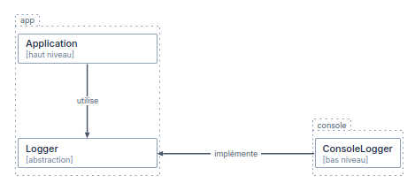
### injection de dépendances
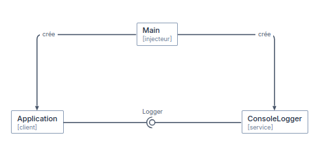
```java
class Application {
    private final Logger logger;

    Application(Logger logger) {
        this.logger = logger;
    }

    void performOperation() {
        logger.log("Performing an operation");
    }

    // (version setter)
    void setLogger(Logger logger) {
        this.logger = logger;
    }
}
// L'injecteur
var app = new Application(new ConsoleLogger());
app.performOperation();

// (version setter)
var app = new Application();
app.setLogger(new ConsoleLogger());
```

**L'injection par le conteneur**
```java
@ApplicationScoped
public class ConsoleLogger implements Logger {
    public void log(String message) { ... }
}

@ApplicationScoped
public class Application {
    @Inject
    Logger logger;

    public void performOperation() {
        logger.log("Performing an operation");
    }
}
```
- `@ApplicationScoped` confie le client et le service au conteneur.
- `@Inject` désigne la dépendance à fournir.
- Le conteneur joue l'injecteur : il crée les objets et les relie. Personne n'écrit `new`.

defaut = constructor
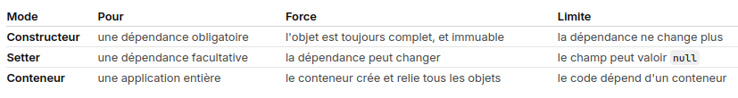

#### L'inversion de contrôle
en gros, l'idée c'est que maintenant, c'est le conteneur qui appelle le code
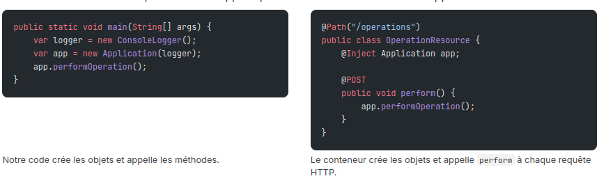

**formes d'inversion de controle** :
- Creation : conteneur crée nos object et gère les dépendance
- Appels : contneur appel les methodes suivant une REQ
- Cycle de vie : conteneur décide gère le life-time des objets

en gros, le conteneur gère la vie de nos object et nos dépendance

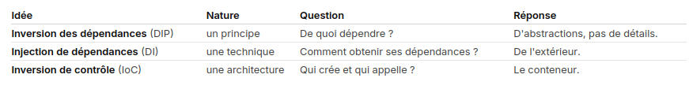

#### Jakarta CDI
- **Jakarta Dependency Injection** définit les annotations de base, dont @Inject.
- **Jakarta Contexts and Dependency Injection** (CDI) définit le conteneur : ce qu'il crée, quand, et comment il l'injecte.
- **Weld** implémente CDI. Helidon l'embarque.

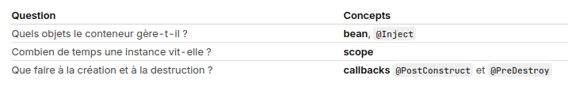
#### bean
c'est un objet que le conteneur crée, inject et détruit
- Une annotation comme `@ApplicationScoped` fait d'une classe un bean.
- Le conteneur injecte un bean partout où `@Inject` demande l'un de ses types : sa classe, ses interfaces.
- Un bean CDI n'est pas un JavaBean, qui est une classe avec getters et setters.

```java
@ApplicationScoped
public class ReservationService {
    @Inject Mailer mailer;                  // champ
    private final PaymentGateway gateway;
    private Statistics statistics;
    @Inject                                 // constructeur
    public ReservationService(PaymentGateway gateway) {
        this.gateway = gateway;
    }

    @Inject                                 // méthode
    void setStatistics(Statistics statistics) {
        this.statistics = statistics;
    }
}
```
*(préférer constructor)*
###### Scope
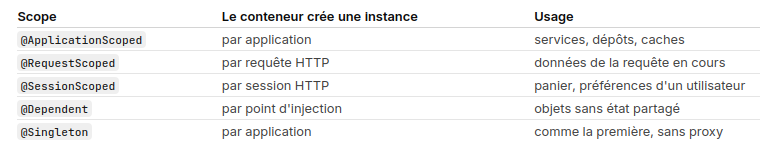
###### choix du scope
`@ApplicationScoped` (si dois être vie toute l'app, c'est un singloton) → `@RequestScoped` (si just utiliser pour une REQ) → `Dependent` (objet que personne d'autre partage)

`@ApplicationScoped` est utiliser par plusieur thread faut géré la concurence

###### Callback
```java
ApplicationScoped
public class SmtpMailer implements Mailer {
    @Inject @Named("sender") String sender;
    public SmtpMailer() {
        System.out.println("Created, sender = " + sender);
    }
    @PostConstruct
    void open() {
        System.out.println("Connected as " + sender);
    }
    @PreDestroy
    void close() {
        System.out.println("Disconnected");
    }
}
```

### Les patterns de Jakarta CDI
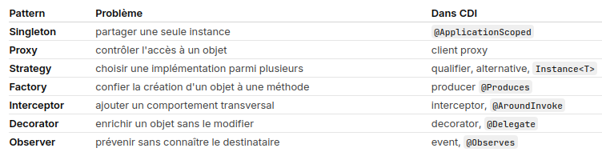

**proxy**


**client proxy**
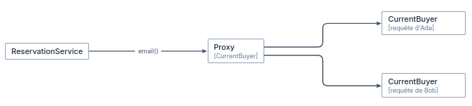

###### La dépendance ambiguë

- Chaque point d'injection doit avoir un fournisseur, et un seul.
- Deux stratégies pour un même contexte : le conteneur ne choisit pas, il refuse de démarrer.
- Aucun bean : il refuse aussi, avec Unsatisfied dependencies.

on utiliser donc `@Named` pour distinger les bean
```java
@Named("card")
@ApplicationScoped
public class CardGateway implements PaymentGateway { ... }

@Named("twint")
@ApplicationScoped
public class TwintGateway implements PaymentGateway { ... }

@ApplicationScoped
public class Checkout {
    @Inject @Named("card") PaymentGateway card;
    @Inject @Named("twint") PaymentGateway twint;
}
```
`@Qualifier` = fait d'une annotation un qualifier.
```java
@Qualifier
@Retention(RUNTIME)
@Target({TYPE, METHOD, FIELD, PARAMETER})
public @interface Card {}

@Card
@ApplicationScoped
public class CardGateway implements PaymentGateway { ... }
```
`@Alternative` = remplace un autre bean du même type, sans toucher aux points d'injection. On utiliser `@Priority(n)` pour donner la prio

`Instance<T>` = choisir la starts a l'execution
```java
@ApplicationScoped
public class Checkout {
    @Inject @Any
    Instance<PaymentGateway> gateways;

    public boolean pay(String method, String email, int amount) {
        for (PaymentGateway gateway : gateways) {
            if (gateway.supports(method)) {
                return gateway.charge(email, amount);
            }
        }
        throw new IllegalArgumentException("No gateway for " + method);
    }
}
```
*`@Any` demande tous les beans du type, quel que soit leur qualifier. Sans lui, `Instance<T>` ne voit que les beans sans qualifier.*

`@Produces` = pour les factory, contneur appel pour crée une objet
```java
@ApplicationScoped
public class Producers {
    @Produces // bim badam bing, factory is going
    Clock clock() {
        return Clock.systemUTC();
    }

    @Produces @Named("sender")
    String sender() {
        return "tickets@baindefoule.ch";
    }
}

@Inject Clock clock;
@Inject @Named("sender") String sender;
```

###### Interceptor
en gros, c'est un proxy mais il modifie le comportement en ajoutant de la logic puis transmet l'appel


binding :
```java
@InterceptorBinding     // crée le binding
@Retention(RUNTIME)
@Target({TYPE, METHOD})
public @interface Logged {}

@Logged
@Interceptor        // dit que c'est l'interceptor
@Priority(Interceptor.Priority.APPLICATION)
public class LoggedInterceptor {
    @AroundInvoke // methods call
    Object log(InvocationContext ctx) throws Exception {
        String name = ctx.getMethod().getName();
        System.out.println("Before " + name);
        try {
            return ctx.proceed();
        } finally {
            System.out.println("After " + name);
        }
    }
}

@Logged
@ApplicationScoped
public class ReservationService {
    public void reserve(String email, int quantity) {
        System.out.println(quantity + " tickets reserved");
    }
}
```

**décorator** = check la super presse de MCR mate
```java
@Decorator
@Priority(Interceptor.Priority.APPLICATION)
public class SignatureDecorator implements Mailer {
    @Inject @Delegate
    Mailer mailer;

    public void send(String to, String message) {
        mailer.send(to, message + " -- Bain de foule");
    }
}
```
**observer**
```java
@ApplicationScoped
public class ReservationService {
    @Inject Event<Reservation> reserved;

    public void reserve(String email, int quantity) {
        reserved.fire(new Reservation(email, quantity));
    }
}

@ApplicationScoped
public class Statistics {
    void onReserved(@Observes Reservation reservation) {
        tickets += reservation.quantity();
    }
}
```

#### Les doublures de test
l'injection rend une classe testable
l'idée c'est que tu passe des objets de test pour voir si tous marche bien
```java
public class ReservationService {
    private static final int PRICE = 90;
    private final PaymentGateway gateway;
    private final Mailer mailer;
    // le constructeur reçoit gateway et mailer a tester
    public boolean reserve(String email, int quantity) {
        if (!gateway.charge(email, quantity * PRICE)) {
            return false;
        }
        mailer.send(email, quantity + " tickets reserved");
        return true;
    }
}
```
###### Arrange, Act, Assert
Un test unitaire se lit en trois temps.
- **Arrange** : le test prépare la classe sous test et ses doublures.
- **Act** : il appelle la méthode à tester.
- **Assert** : il vérifie le résultat.

###### Mockito
Mockito fabrique une doublure à partir d'une interface ou d'une classe.
```java
PaymentGateway gateway = mock(PaymentGateway.class);
gateway.charge("ada@example.com", 180);   // false
```
###### pattern Stub
- Stub gère les dépendance qui fournice des données
- le Test prepare les reponses du stub et call la classes de sous test
- le test check les resultas

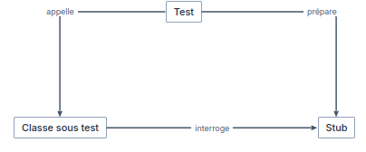
```java
@Test
void reservesWhenThePaymentIsAccepted() {
    // Arrange
    PaymentGateway gateway = mock(PaymentGateway.class);
    Mailer mailer = mock(Mailer.class);
    when(gateway.charge("ada@example.com", 180)).thenReturn(true);
    var service = new ReservationService(gateway, mailer);

    // Act
    boolean reserved = service.reserve("ada@example.com", 2);

    // Assert
    assertTrue(reserved);
}
```

###### pattern Mock
- Mock gère les dépendance call la class de sous-test
- Le test check les appels après coup

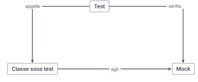
```java
@Test
void sendsTheConfirmation() {
    // Arrange
    PaymentGateway gateway = mock(PaymentGateway.class);
    Mailer mailer = mock(Mailer.class);
    when(gateway.charge("ada@example.com", 180)).thenReturn(true);
    var service = new ReservationService(gateway, mailer);

    // Act
    service.reserve("ada@example.com", 2);

    // Assert
    verify(mailer).send("ada@example.com", "2 tickets reserved");
}
```

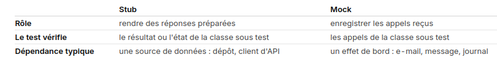

###### Le fake (doublure) 💸💸💸💸 🥀🥀🥀🥀
- c'est une vrais implémentaion mais simplfier
- Le test l'interroge comme un objet classic

```java
class FakeMailer implements Mailer {
    private final List<String> sent = new ArrayList<>();

    public void send(String to, String message) {
        sent.add(to + ": " + message);
    }

    List<String> sent() {
        return sent;
    }
}
```

à utiliser :
- Remplacer ce qui sort du processus : une API externe, une base de données, des fichiers, l'horloge.
- Ne pas remplacer un objet valeur, ni la classe sous test.
- Vérifier seulement les appels qui comptent pour le métier.

### Tester une application CDI
- `@HelidonTest` démarre le conteneur pour la classe test
- conteneur inject les vais beans
- Test check l'assemblage

```java
@HelidonTest
class ReservationServiceTest {
    @Inject
    ReservationService service;

    @Test
    void reserves() {
        assertTrue(service.reserve("ada@example.com", 2));
    }
}
```
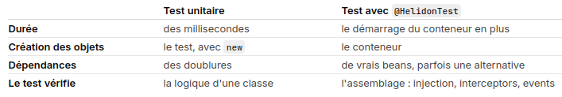