# Kotlin


# Android 💀
l'app a un fichier manifeste qui permmet a android de savoir les truc de base de cette app
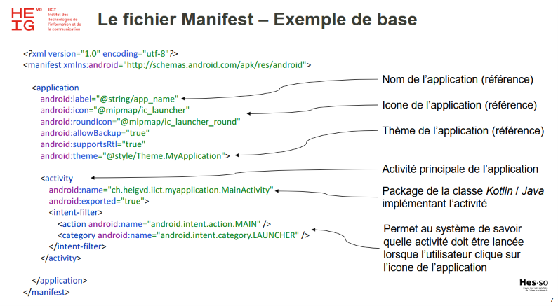
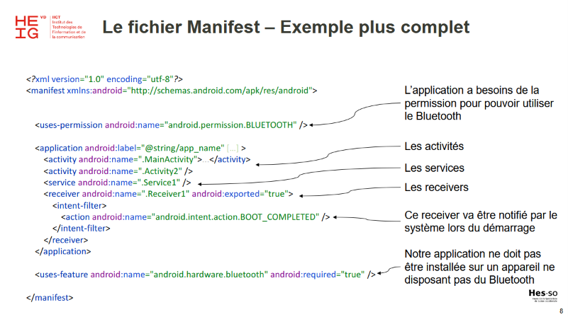
### Ressource
#### String
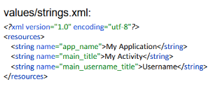
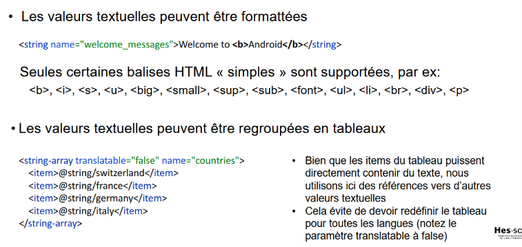
#### Dimention
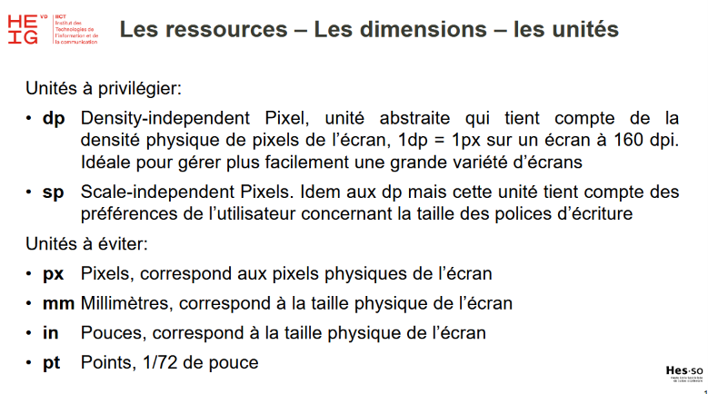
#### Color
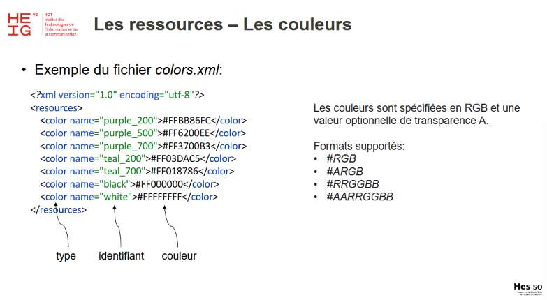
#### Theme

#### Drawables


### Widgets (view)
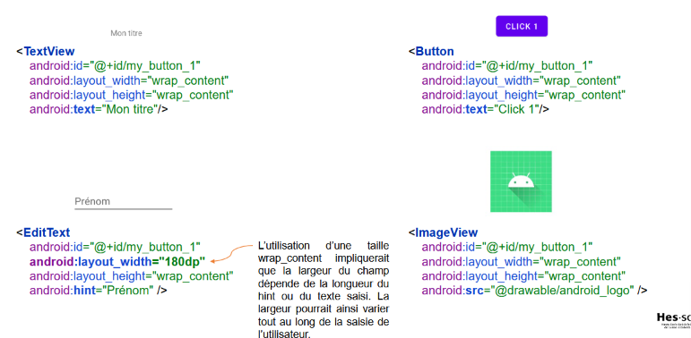

### Layout
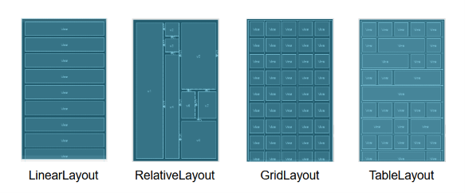
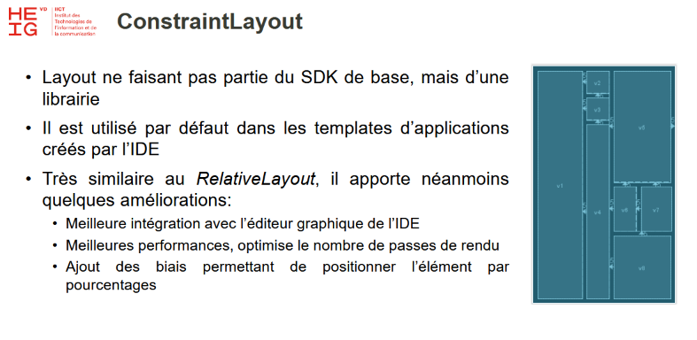
##### Scroll view
c'est un *ViewGroup* lol
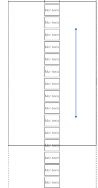

## Layout 2
- view = éléments graphique → widget
- viewGoup = Containers → Layout

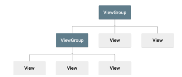

### Type de layout

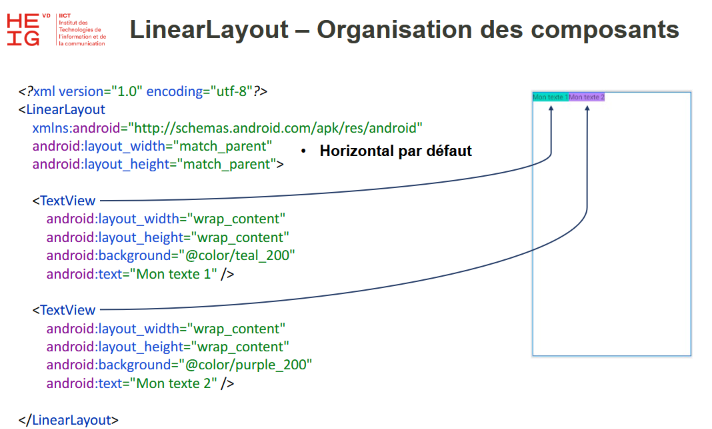


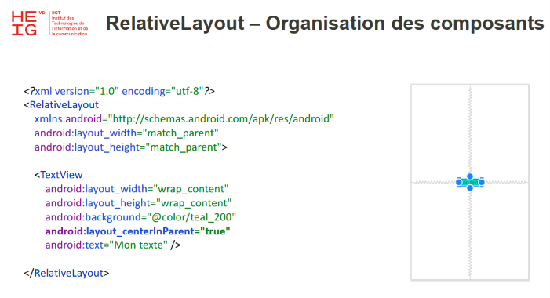
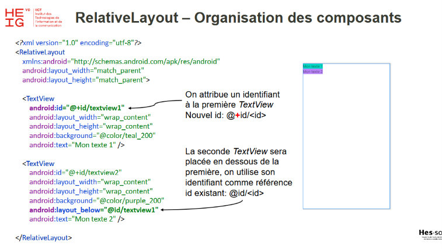

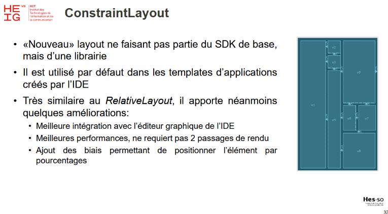
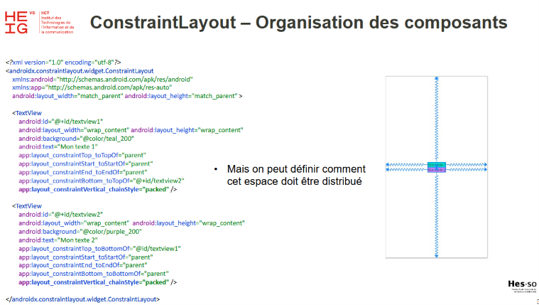


## Activité, Fragements et service
- Activité = brique de base toute application, c'est genre les écran
- Fragment = c'est des partie d'ui
- Service = c'est de mini thread

#### Activité
###### Déclaration

###### Cycle de vie

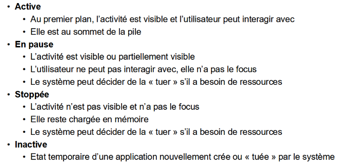


###### create
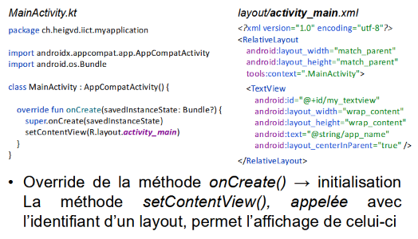


find by id


pour evitre géré les nullables

avec **lateinit**

##### Gestion de click


##### Run activity
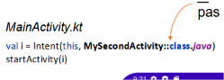

##### Passé des valeurs
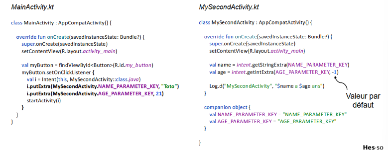

##### Passé un resulta


##### Contrat (adnroidX)
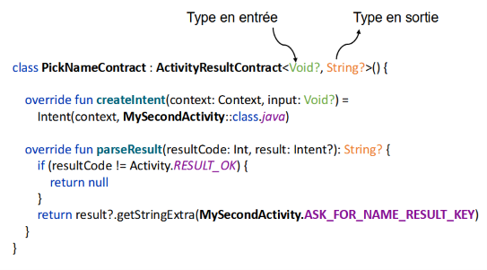
utilisation


##### Intents
###### Explicite
```java
val i = Intent(this, MySecondActivity::class.java)
startActivity(i)
```
Servent a démarrer une activité précice

###### Implicite
```java
val i = Intent(Intent.ACTION_VIEW)
i.setData(Uri.parse("https://www.heig-vd.ch"))
startActivity(i)
```
Servent a lancer une activité générique, genre pour demander d'ouvrir une lien par exemple

btw faut pas oblier de dire dans le manifest qu'on peu aller sur le site donner par exemple avec


#### Fragment
###### FragmentContainerView
les fragements devoie être contenue dans un FragmentContainerView

on vas le remplacer


quand on change d'orentation, on recrée toute les fragement
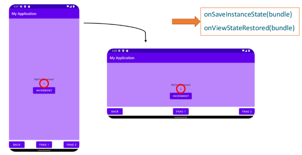


#### Service
3 type de bimdning
- Forground = lié avec une notif visible de l'utilisateur → download, lecteur audio
  discard since API 31
- Background = sans interface avec le user, limiter dans le temps → sync server, save
- Bound = lié a un composant d'une app (souvant activité). Detruit si y a plus de composant bindé avec


###### Background
démaré
```java
val i = Intent(this, MyService::class.java)
startService(i)
```
startService renvoie un flag:
- START_STICKY = demande au système de redémarrer le service dès que possible (Intent vide)
- START_NOT_STICKY = le système ne doit pas redémarrer le service
- START_REDELIVER_INTENT =  système redémarre le service avec l’Intent d’origine

si on le stop pas, le service s'arrête si :
- l'app est stopé par le user
- le system kill l'app (STICKY marche pas dans ce cas)

###### Bounded
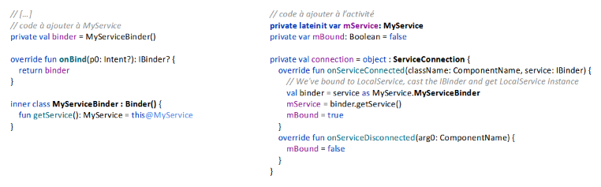


#### Broadcast
###### Braodcast Receivers
ça recoie des message envoyer par le system
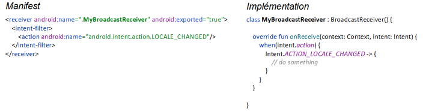


##### Content Providers
c'est une interface pour accédé au donné du style Contact, Calendirer, Journal d'appel, Media

##### Permision
on peut placer ça pour catch si il manque la permision


y a aussi c'est notation
