# Kotlin


# Android 💀
l'app a un fichier manifeste qui permmet a android de savoir les truc de base de cette app


### Ressource
##### Contextulisation des ressources
L'idée c'est que tu peux avoir plusieur ressource différente suivant le context (exemple langue avec en, fr)

on peut crée des ressource contextualiser (faut just faire gaff, c'est pas libre faut checker la doc)

##### R Class
En gros, depuis le code on a besoin d'acceder au ressource (genre manifest) pour ça une class R est crée. Elle permette de maper les ressource pour qu'elle sois accésible depuis le code

elle est généré au build a la racine du package

c'est aussi ça qui gère les référencer les ressource depuit les layout

exemple d'utilisation
`R.layout.activity_main` → ref au layout de l'activité main


#### String


#### Dimention

#### Color

#### Theme
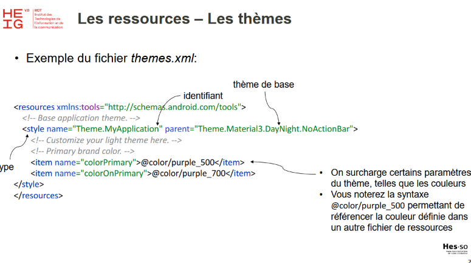
#### Drawables
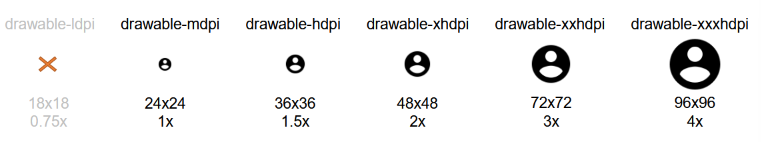

### Widgets (view)


### Layout


##### Scroll view
c'est un *ViewGroup* lol


## Layout 2
- view = éléments graphique → widget
- viewGoup = Containers → Layout


### Type de layout
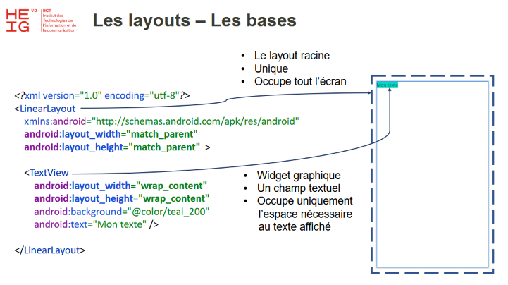

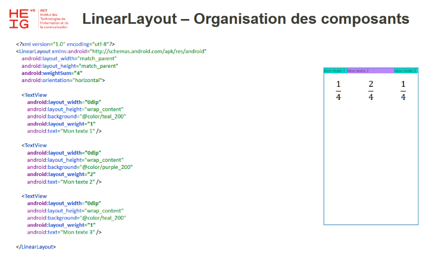


## Activité, Fragements et service
- Activité = brique de base toute application, c'est genre les écran
- Fragment = c'est des partie d'ui
- Service = c'est de mini thread

#### Activité
###### Déclaration
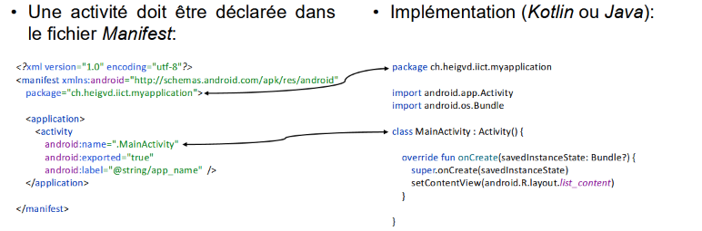
###### Cycle de vie
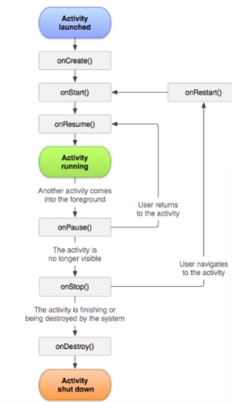

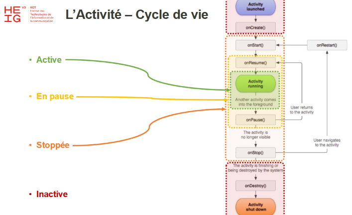

l'activité est stoppé quand :
sav = l'activité est sauvegardé
- l'app est tué
- (sav) switch ver une autre activité
- (sav) rotation d'écran
- (sav) changement de paramètre autre

en régle général, si l'activité risque d'être reutilser bientot, on save

###### Pile
Les activité s'empile
- Quand on back, on appel `finish()` sur l'activité actuel → et on restore la precédent
- le system peut tuer des activité pas en premier plan pour economiser de la ressource
  - si c'est le cas, quand on back dessus, on vas recrée une nouvel instance de l'activité

###### Save/restore
`OnSaveInstance(outState : Bundle)` est appler pour save une activité

Bundle = hashmap(id, donnés)

le system save automatiquement **les widget qui on des id**

#### Intent
Explicite :
```java
val i = Intent(this, MySecondActivity::class.java)
startActivity(i)
```
démare une activité présice (normalment de la meme app)

implicite :
```java
val i = Intent(Intent.ACTION_VIEW)
i.setData(Uri.parse("https://www.heig-vd.ch"))
startActivity(i)
```
Servent a lancer une activité générique, genre pour demander d'ouvrir une lien par exemple

btw faut pas oblier de dire dans le manifest qu'on peu aller sur le site donner par exemple avec
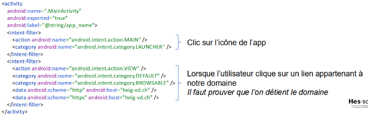


###### create

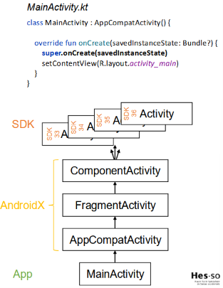

find by id
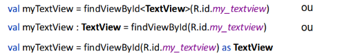

pour evitre géré les nullables
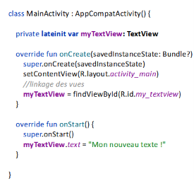
avec **lateinit**

##### Gestion de click
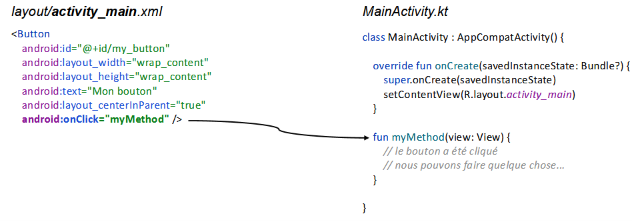

##### Run activity


##### Passé des valeurs


##### Passé un resulta
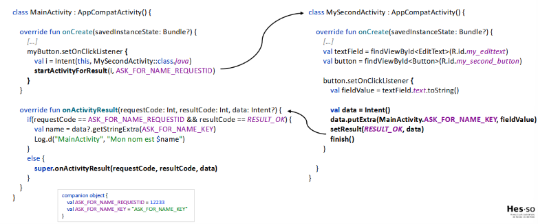

##### Contrat (adnroidX)

utilisation
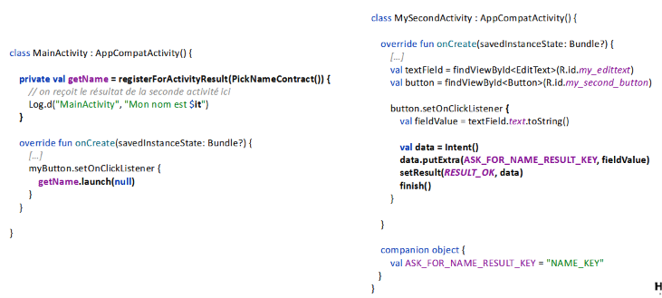

#### Fragment
###### FragmentContainerView
les fragements devoie être contenue dans un FragmentContainerView

on vas le remplacer
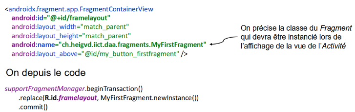

quand on change d'orentation, on recrée toute les fragement


#### Service
3 type de bimdning
- Forground = lié avec une notif visible de l'utilisateur → download, lecteur audio
  discard since API 31
- Background = sans interface avec le user, limiter dans le temps → sync server, save
- Bound = lié a un composant d'une app (souvant activité). Detruit si y a plus de composant bindé avec

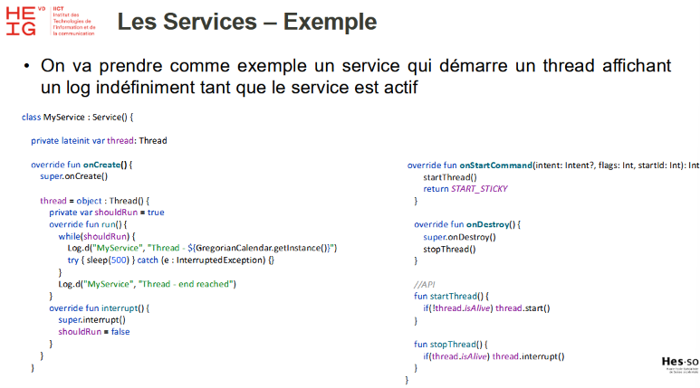

###### Background
démaré
```java
val i = Intent(this, MyService::class.java)
startService(i)
```
startService renvoie un flag:
- START_STICKY = demande au système de redémarrer le service dès que possible (Intent vide)
- START_NOT_STICKY = le système ne doit pas redémarrer le service
- START_REDELIVER_INTENT =  système redémarre le service avec l’Intent d’origine

si on le stop pas, le service s'arrête si :
- l'app est stopé par le user
- le system kill l'app (STICKY marche pas dans ce cas)

###### Bounded

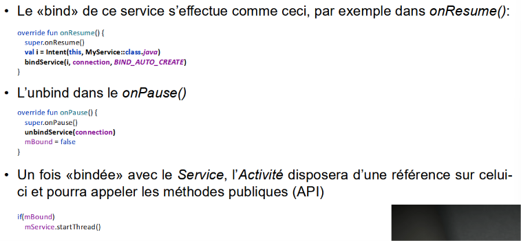

#### Broadcast
###### Braodcast Receivers
ça recoie des message envoyer par le system

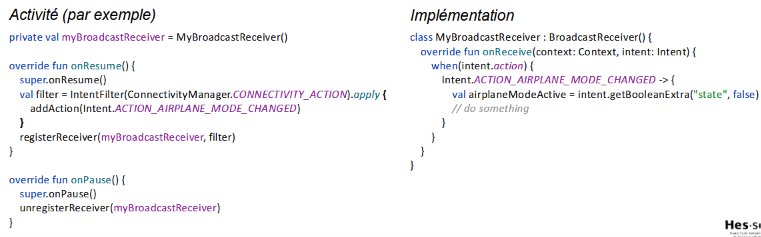

##### Content Providers
c'est une interface pour accédé au donné du style Contact, Calendirer, Journal d'appel, Media

##### Permision
on peut placer ça pour catch si il manque la permision
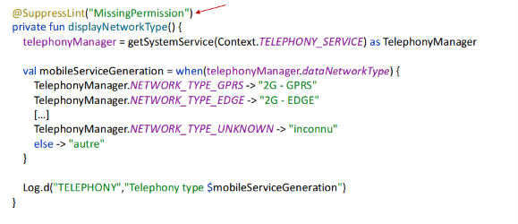

y a aussi c'est notation
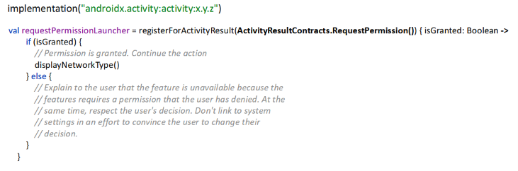

## Vue
une vue peut être :
- VISIBLE : defaut
- INVISIBLE : pas afficher, mais toujour pirse en compte, genre comme "opacity = 0"
- GONE : caché comme si elle avait jamais exister

#### Principal vues
###### Textview
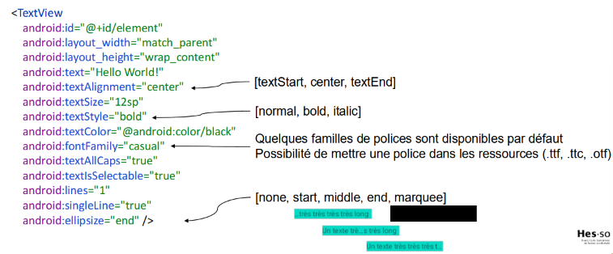
###### EditText
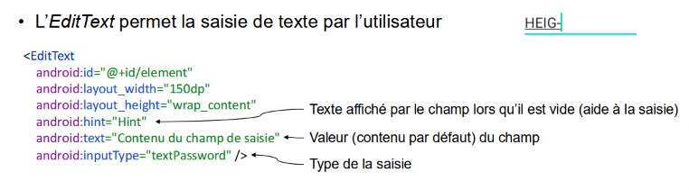
btw
```java
getText(); // CharSequence
editValue.text = "text"; // compile pas
editValue.setText("text") // good
```
on peux crée un TextWatcher pour être notifier
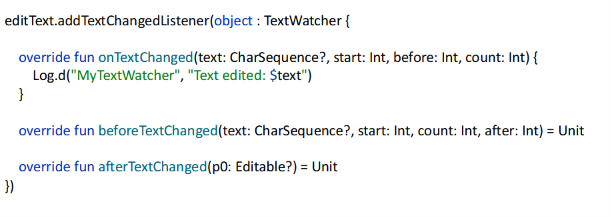
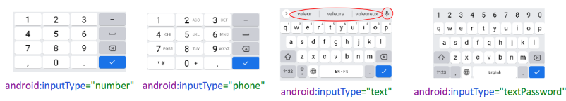

###### Button
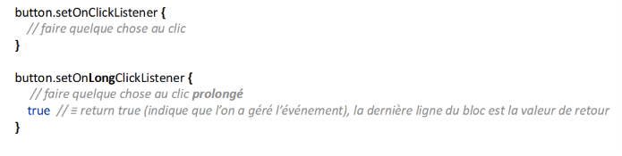

###### ImageView
```xml
<ImageView
android:id="@+id/element"
android:layout_width="300dp"
android:layout_height="300dp"
android:layout_centerInParent="true"
android:contentDescription="@string/image_description"
android:src="@drawable/android"
android:scaleType="fitCenter" />
```
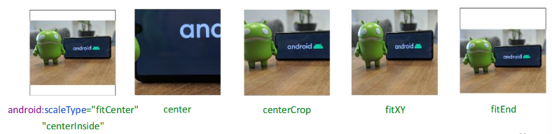

###### Spinner
*strings.xml*
```xml
<string-array name="super-data">
  <item>Str 1</item>
  <item>str </item>
</string-array>
```
```xml
<Spinner
android:id="@+id/element"
android:layout_width="wrap_content"
android:layout_height="wrap_content"
android:layout_centerInParent="true"
android:entries="@array/super-data" />
```

pour skip la limitation de devoir passé par les ressources, on peut utiliser un **Adapter**
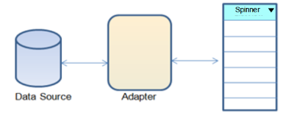
plus complex mais permette d'être dynamique
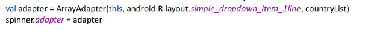
update le spinner
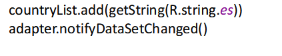
###### WebView
c'est une Iframe en gros
c'est souvent utiliser pour charger du contenue local pour fair de l'ui facile, tous ça
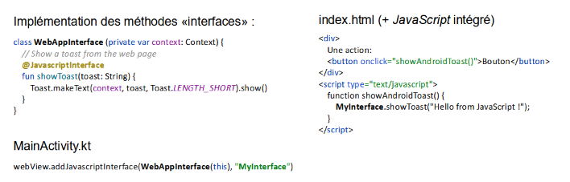
on peut appler du code de l'app depuit de JS du coup

Aussi, on doit extend les vue pour les utiliser a leur plein potentiel
genre depuis l'XML, on peut pas choisir l'URL de base

#### Crée ça vue
les views on 4 constructeur
```java
public View(Context context)
public View(Context context, @Nullable AttributeSet attrs)
public View(Context context, @Nullable AttributeSet attrs, int defStyleAttr)
public View(Context context, @Nullable AttributeSet attrs, int defStyleAttr, int defStyleRes)
```
version short-hand kotlin
```java
class MyCustomWebView (context: Context,
  attrs: AttributeSet? = null,
  defStyle: Int = 0,
  defStyleRes : Int = 0
) : WebView(context, attrs, defStyle, defStyleRes)
```

`@JvmOverloads` = annotation demande au compilateur de crée un constrcteur qui substituent les valeur par defaut

`onDraw(canvas : Canvas)` appel au render
`onTouchEvent(event : MotionEvent) : Boolean` callback quand le user touche
###### Material Components
c'est just les vue de google
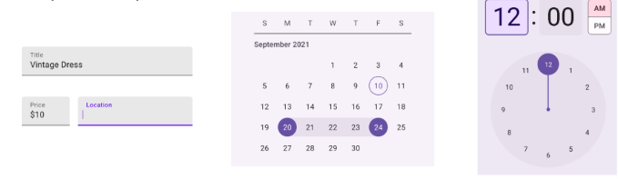
#### UI-Thread
L'Activité run sur une thread (le UI-thread)
Si l'action est trop groumand → freez
si y a ce genre de truc → go lancer sur un autre thread

**Download une image ça fait freez**
kotlin short hand pour lancer une thread
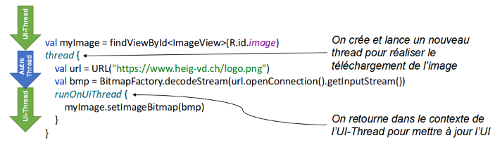


##### Toast
c'est les pop-ui en bas
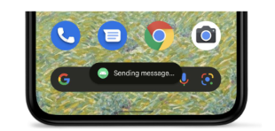
```java
Toast.makeText(this, "Sending message...", Toast.LENGTH_SHORT).show()
```
**Snackbar** la version google des toasts

##### Dialog
c'est une pop-up qui demande un truc
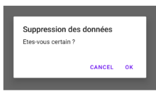
```java
val dialog = AlertDialog.Builder(this)
  .setTitle("Suppression des données")
  .setMessage("Etes-vous certain ?")
  .setCancelable(false) // dialog cannot be closed without doing a choice
  .setNegativeButton(android.R.string.cancel) { _,_ ->
    // cancel action
  }
  .setPositiveButton(android.R.string.yes) { _,_ ->
    // apply action
  }
  .create()
dialog.show()
```
###### Custom
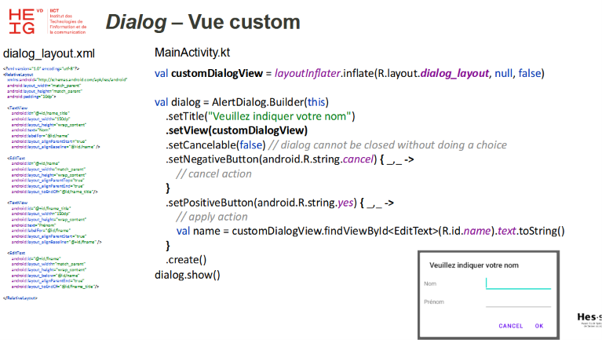

### Notification
c'est Async
##### Canaux
Depuis android 8.0
les notif doit être associer a un Canal
En gros, ça permette de pouvoir categoriser les notifs (exemple, message et alert par exemple)

Pour en crée un il faut
- un channel id = `private val CHANNEL_ID = "discussion"`
- et le crée :
  ```java
  private fun createNotificationChannel() {
    if (Build.VERSION.SDK_INT >= Build.VERSION_CODES.O) { // > 97% du marché
      val name = getString(R.string.channel_name) // Discussions
      val importance = NotificationManager.IMPORTANCE_DEFAULT
      val channel = NotificationChannel(CHANNEL_ID, name, importance).apply {
        description = descriptionText
      }
      // Register the channel with the system
      val notificationManager: NotificationManager = getSystemService(Context.NOTIFICATION_SERVICE)
      as NotificationManager
      notificationManager.createNotificationChannel(channel)
    }
  }
  ```
- Si le Canal n'existe pas → fait just rien
- c'est crée grace a **Builder** (exemple : *Compat*)
  ```java
  val notif = NotificationCompat.Builder(this, CHANNEL_ID)
    .setSmallIcon(R.drawable.pencil)
    .setContentTitle("Titre")
    .setContentText("Lorem ipsum dolor sit amet, consectetur […] et dolore magna aliqua.")
    .setPriority(NotificationCompat.PRIORITY_DEFAULT)
    .build()
  with(NotificationManagerCompat.from(this)) {
    notify(notificationId, notif)
  }
  ```

###### Action
On peut associer des actions au notification avec `PendingIntent`
c'est un `Intent` encapsuler

```java
val intent = Intent(this, MainActivity::class.java).apply {
  flags = Intent.FLAG_ACTIVITY_NEW_TASK or Intent.FLAG_ACTIVITY_CLEAR_TASK
}
val pendingIntent = PendingIntent.getActivity(this, 0, intent, PendingIntent.FLAG_IMMUTABLE)


NotificationCompat.Builder(this, CHANNEL_ID)
.setSmallIcon(R.drawable.pencil)
.setContentIntent(pendingIntent)
.setAutoCancel(true)
.build()
```

pour pourvoir crée une pile d'intent cohérente, on vas souvent appler un truc comme ça
```java
val pendingIntent = TaskStackBuilder.create(this).run {
  addNextIntentWithParentStack(intent)
  getPendingIntent(0, PendingIntent. FLAG_IMMUTABLE)
}
```
et indiquer dans le manifest
```XML
<activity android:name=".InboxActivity" />
<activity android:name=".ReadEmailActivity"
  android:parentActivityName=".InboxActivity "/>
```

bw on peut ajouter autant d'action que l'on veux avec :
```java
.addAction(R.drawable.action1, "Action 1", pendingIntentAction1)
```

chacun aura sont propre `PendingIntent`
###### Expendable
```java
.setLargeIcon(BitmapFactory.decodeResource(resources, R.drawable.android))
.setStyle(NotificationCompat.BigTextStyle()
  .bigText(text))
```
pour ça
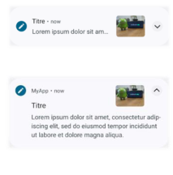

### Action bar
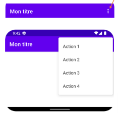
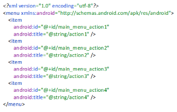
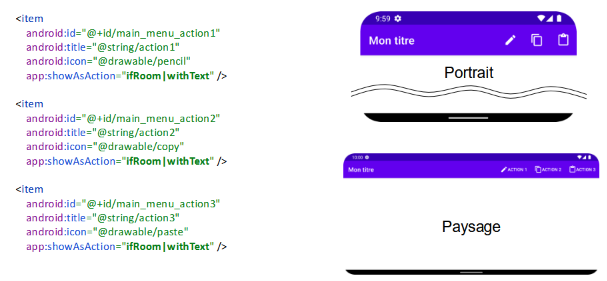

### ListView
connait nit le type ni le nombre de ses ellements
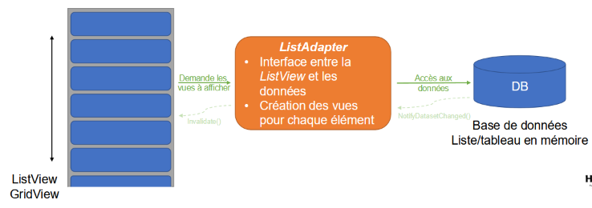
en gros, on utiliser un Adapter et le meme trick qu'on utilise pour faire des scroll infini (sois repeter teleporter des elements et just recycler les meme elements)
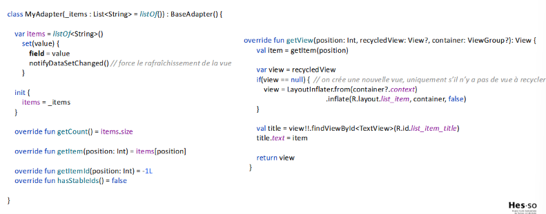

### RecyclerView
la versio modernde des list view
elle standardise la manière de géré c'est elements en imposant le `ViewHolder`

ça ce déclare pareille mais just rajouter le `layoutManager`

le `ViewHolder` est defini comme un class interne

```java
  class MyRecyclerAdapter(_items : List<Animal> = listOf()) : RecyclerView.Adapter<MyRecyclerAdapter.ViewHolder>() {
  override fun onCreateViewHolder(parent: ViewGroup, viewType: Int): ViewHolder {
    return when(viewType) {
      MAMMAL -> ViewHolder(LayoutInflater.from(parent.context).inflate(R.   layout.list_item_mammal, parent, false))
      else /* AVES */ -> ViewHolder(LayoutInflater.from(parent.context).    inflate(R.layout.list_item_aves, parent, false))
    }
  }
  override fun onBindViewHolder(holder: ViewHolder, position: Int) {
    holder.bind(items[position])
  }
  inner class ViewHolder(view: View) : RecyclerView.ViewHolder(view) {
    private val nameMammal = view.findViewById<TextView>(R.id.list_item_mammal_name)
    private val nameAves = view.findViewById<TextView>(R.id.list_item_aves_name)
    fun bind(animal : Animal) {
      if(animal is Mammal) nameMammal?.text = animal.name
      else nameAves?.text = animal.name
    }
  }
}
```

le `DiffUtil` compar les 2 lists est update seulment les élément modifier


## LiveData et Architecture MVVM
#### LiveData
c'est une class d'observable qui encapsulant un type generique de donné
- Lifecycle : il repect le cycle de vie des composants qui l'observent
  - onCreated
  - onStart
  - onPause
  - onDestroy
  - onStop
  - onResume
Ils sont généralement crée dans lve ViewModel


###### Avantage
- pas de memory leak
- update l'UI automatiquement
- peut être modifier depuis l'UI (vue que géré avec UI-thread)
- permette  de save l'état d'ui a la re-creation
- permette de partager des donner a traver les activité et fragment

LiveData pas modifiable → pour ça faut utiliser `MutableLiveData`

```java
val data = MutableLiveData(1)
data.value = 2 // sync change
data.postVaue(2) //async change
// depuit activité
data.observe(this){value ->
  ...
}

// depui Fragement
data.observe(viewLifecycleOwner) { value ->
  ...
}
```

##### Transformations
on peut crée LiveData dont le contenue est une version tranfromer d'un autre LiveData (auto sync)

```java
val users = MutableLiveData(listOf(
    User("Philibert", "Guillaume"),
    User("Berthe", "Crozier")))

private val userNames : LiveData<List<String>> = users.map { usersList ->
  var listOfNames = mutableListOf<String>()
  for(user in usersList)
    listOfNames.add("${user.firstname} ${user.name}")
    listOfNames.toList() // dernière ligne ≡ valeur de retour
}
```
##### MediatorLiveData
Permette de fusionner 2 LiveData
```java
val ld = MediatorLiveData<Int>().apply {
  addSource(ld1) { v -> value = v } // on source1 change
  addSource(ld2) { v -> value = v.toInt() } // on source2 change, on convertit la valeur textuelle en entier
}
```
### MVVM
en gros, le MVC c'est pas applicable sur android de base parce que
- les vues peuvent pas interagire directement avec les model
- du coup on peut pas avoir le model qui update le view :[
- aussi, le fait que les Activité et Fragement on leur propre life time aide pas

##### Model View ViewModel est là pour nous sauver lol
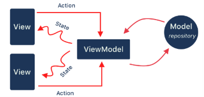

#### ViewModel
c'est une lib d'android jetpack
- il vas ce link a une Activiter et suivre ses re-creation
- le meme ViewModel peut être reféré par une Activité et ses Fragements
- pas disigner pour stocker des donner a long terme → durée de vie limiter a celle de l'activité
- c'est du lazy loading
- Un ViewModel par activité, instanci une nouveau pour chaque activité

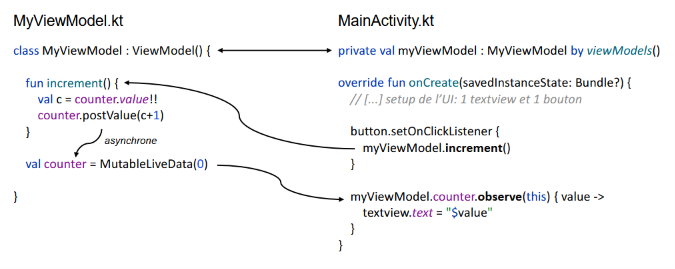

si on veux ajouter des argument au constructeur du ViewModel, faut definir une factory
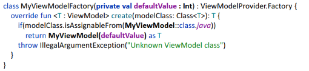

*choper une ViewModel depuit un Fragements*
```java
private val myViewModel : MyViewModel by activityViewModels()

// si passe par une factory
val myViewModel : MyViewModel by activityViewModels {
  MyViewModelFactory(10)
}
```

Faut jamais que le ViewModel ai une ref ver de l'ui ou un controller tous autre object utilisant le `Contexte` d'une Activité

##### Bonne pratique
- ViewModel ne doit jamais être référencer par : Vue, Activité, Fragement ou n'imp quel obj de Context d'Activité
- possible de crée plusieur ViewModel dans une meme Activité ou Fragement
- ViewModel pas pour les donné a long terme
  - durée de vie limiter
  - lier a la l'activité / Fragement qu'il la crée
- éviter de rendre une MutableLiveData publique
