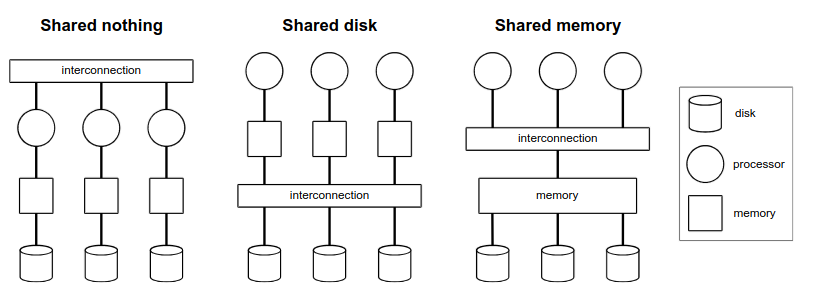

# Modèle de Distribution et Cohérence
SGBD = Système de gestion de base de données
#### Architecture

### Distribution
2 type de d'aproche générique :
- Pratitionner (sharding) : diviser la base en sous ensemble de données
- Replication : copyer la base sur une autre node
*Modèles de distribution* = algo pour distribuer

#### Log de réplication
###### Statement-based replication
- log chaque requête d'ecriture exécuter

**problème** :
- NOW(), RAND(), etc. change a chaque execution
- Les instruction UPDATE ... where doivent être executer dans un ordre precis, si non ça casse
- instruction a side effect peut avoir d'autre side effect si executer ailler
###### Write-ahead log (WAL)
- log une sequence d'octets qui correspond au resulta d'une ecriture
- les client on just a la copier sur le disque
**problème** :
- dépendant du moteur de stockage
- si y a une changement dans le stockage suite a une update → 💀
*PostgreSQL* et *Oracle*
###### Logical (row-based) log
l'idée est de découper le format de log du format de stockage

on stock donc souvent :
- Ligne inséré
- Ligne supprimée
- Ligne mise à jours
avec les info pour les identifier

**avantage** :
- rétro-compatbilité (vue qu'indépendant du format de stockage)
- facile a analyser par une app externe

###### Trigger-based replication
Dans le cas où on a besoin de sortire du cardre de la base de donné classic, on peut déplacer la replication sur la couche application

approche plus couteuse et est plus risquer car on sait plus faire de logiciel

*Bucardo pour PostgreSQL* et *Oracle* le font

permette de : réplique des sous-ensemble de donné, repliquer un type de base a une autre et ajouter des logic de resolution de conflis

on a donc :
- **Trigger** : save la modif sur un table a part pour pouvoir être lue par un programme externe
- **Process exeterne** : applique la logic

#### Problèmes de délai de réplication
quand on est en **sync** et qu'il y a une couille dans le reseau → 💀
aussi plus y a de noeud, plus ça risque d'arriver

quand on est **async** on peut dé-sync et du coup on est incohérent pendant un temps (c'est applé "cohérence éventuelle")

#### Problème Lecture-écriture (Reading Your Own Writes)
si tu lit une donné depuit un noeud pas sync avec le reste ça peut crée des incoéhrence

pour reglé ça faut s'assuré que le user lit les donné qu'il a écrit (genre si tu push puit lit, bah tu voie le push), pas forcément le cas pour les autre users

**Tech** :
- quand on lit un truc qui a pue être modifier → privilégier la version du leader
- dans le temps just après une maj de la base (genre 2 - 3 min)→ lire depuis le leader
- le client peux être orienter ver un data base qui eu sa maj en priorité
- timestamp logic
-
#### Problème Lecture monotones
2 requet mais pas la meme reponce parceque les noeud était pas update

pour réglé :
- avoir une cohérence de lecture entre les user, genre un user devrais être renvoier ver le meme noeud

#### Resoudre le problème de délais
si c'est un délais accéptable → on s'en fous
sinon → on fait un system

### Algo de replication
##### Leader unique
y a une node qui est leader, les autre suivent. Peut être **sync** ou non. Dans le cas **async** faut faire gaff, vue que le leader peut crach et on ce retrouve avec une base incohérente sur les autre nodes (genre écriture perdu).
**Semi-sync** exits ou genre, y a un follower qui est sync et les autre non

**ajouter une folower** :
- snapshot de la base
- copier la snapshot
- demander les dernière modif depuis la snapshot au leader
- appliquer les modif (catch-up)
**Si pan** :
- follower : catch-up quand revien
- leader : un follower est elu leader, faut just reconfig les client pour qu'il se sync sur le nouveau leader
##### Multi-leader
plusieur noeud accept les écritures au lieux de 1

En gros, quand y a noeud qui écrit, elle le dit et les autre repliques

pour géré les conflit et problème de cohérence :
on utilise **vecteur de version**

bref a eviter car ça amène plein de merde mais utile pour  :
- Opération off-ligne : calendrier sur mobile et descktop
- Collaborative editing : google doc

##### Replication sans leader (Dynamo-style)
*Dynamo*

En gros, no more leader, tous le monde est chef

quand on écrit ça peut être la merde si une des noeud était en pan, vue que la lecture devien incohérente. Pour eviter ça, on lit aussi sur plusieur node avec un num de version pour trier
###### Quorums de lecture et d'écriture
- pour $n$ répliques
- chaque écriture doit être confirmer par $w$ noeuds
- on lit $r$ noeuds
- si $w + r > n$, on est sure de choper une lecture correcte vue qu'il y a au moins un noeud a jours

$n$ = nombre impaire (3 ou 5)
$w = r = (n + 1) / 2$ (arrondi au supérieur)

