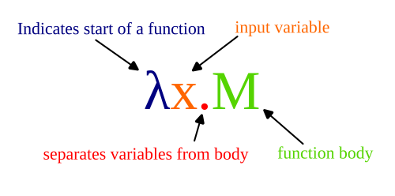

# Vocabulaire
Inférez = donner la signature de la function
test x = x → test :: a => a -> a

## Signature
si besoin de plusieur intreface pour un type A :
`func :: (Ord a, Enum a) => a -> a`

# 06
## Functor

## Applicatives

### Monads

## Lazy evalutaion

## Lambda Calculus

### Status
exemple : $\lambda y. (\lambda z. x y z) z$
- $x$ dans $x y z$ est present nulepar, donc il est free avec un binding none
- $y$ dans $x y z$ est definit par $\lambda y$ qui est externe, donc il est Bound a avec un binding outer
- $z$ dans $x y z$ est bound et inner
- last $z$ est free et none

### Beta reduction

$(\lambda x. \lambda y. x y) (\lambda x . x x)$
- $(\lambda y. (\lambda x . x x) y)$
- $(\lambda y. yy)$

### Eta reduction