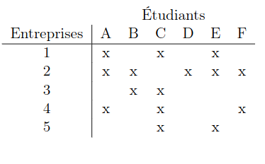

# Trouver le nombre de plage de rendez-vous optimal entre 2 groupe

En gros, on prend un graph $G = (A \cup B, E) bi-partie avec $A$ le group 1, $B$ le group 2
et avec les arète $E$ représentant si un membre du group 1 a un rendez-vous avec un ,menbre du group B.

Dans ce graph, trouver le nombre de plage optimal revien a trouver le nombre **optimal de coloration d'arrete**

Pour ce fair, nous allons :
- compléter le graph pour qu'il y ai le meme nombre de sommets dans $A$ que dans $B$ ansi que fair en sort que les sommets ai tous le meme dergée (crée un graph complet en gros)
- cherche le couplage parfait dans le graph optenue
- colorier le couplage avec un couleur $c$ et retier les arrête concerné
- recompencé tant qu'il nous reste des couplages possible avec des couleur différente a chaque fois

