# Trouver le nombre de plage de rendez-vous optimal entre 2 groupe

En gros, on prend un graph $G = (A \cup B, E) bi-partie avec $A$ le group 1, $B$ le group 2
et avec les arète $E$ représentant si un membre du group 1 a un rendez-vous avec un ,menbre du group B.

Dans ce graph, trouver le nombre de plage optimal revien a trouver le nombre **optimal de coloration d'arrete**

Pour ce fair, nous allons :
- compléter le graph pour qu'il y ai le meme nombre de sommets dans $A$ que dans $B$ ansi que fair en sort que les sommets ai tous le meme dergée (crée un graph complet en gros)
- cherche le couplage parfait dans le graph optenue
- colorier le couplage avec un couleur $c$ et retier les arrête concerné
- recompencé tant qu'il nous reste des couplages possible avec des couleur différente a chaque fois

# Heuristique et approximation

### Coloraion de graph
m = nombre d'arêtes / n = nombre de sommets
###### LF (Largest-First) {O(m + n)}
colorier le sommets avec le plus grand dégré
###### SL (Smallest-Last) {O(m + n)}
trier par ordre de degré croisants → prendre par ordre inverse
(traitement des égalite durant le premier trie)
###### DESATUR {O(n^2)}
Plus grand dégré, si non plus grand degre de saturation

###### RLF (Recusive largest First) {O(n*m)}
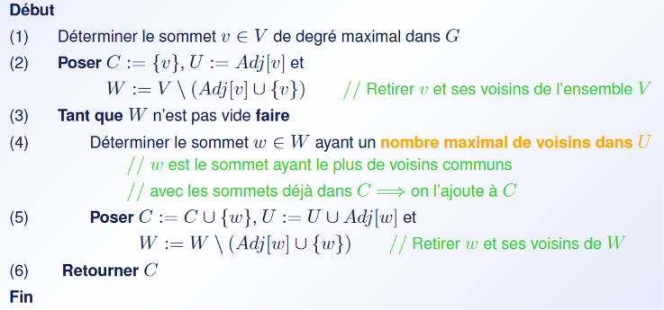
en gros :
1. chosire le sommets de plus haut degré (+déterminer en cas d'égaliter)
2. ban ses sommets voisins
3. colorier le sommets avec la couleur **K**
4. recomancer (1) tanqu'il reste des sommets chosiable et non colorier
5. faire **K + 1**
6. répété depui (1)

**!!! quand un sommets est colorier, on le retire du graph, donc il compte plus pour les degré !!!**
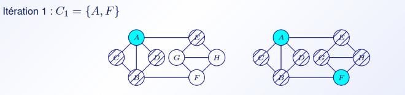
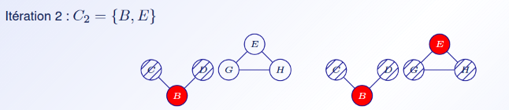
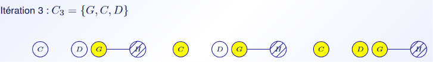

###### Perfomance
DESATURe et RLF sont optimales poure les gaphes bipatis

### Voyageur de comerce
L'idée du problème est de trouver la tounrée la plus court passan par tous les sommets
*Inégalité triangulaire* = $d(i,j) + d(j,k) \ge d(i,j)$

##### Heuristique
###### Plus proche voisin
choisire une ville au hazard → choire la vile la plus proche de celle-ci → repeate
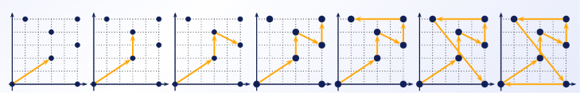
(version "par les deux bouts" veux dire qu'on fait le tours des 2 sense en partant de la vile de base)
###### Goulton
l'idée est de construire un cycle hamiltonien
1. parcourt les arètes de la plus courte à la plus long et sélectionner une arète si
   1. elle ne crée aucun sous-tour (donc un tour qui a une longueur $n<|V|$)
   2. elle ne cére aucun sommets de degré 3

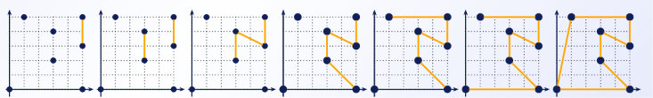
###### Inertion la moins chère/plus chère
1. Construire une tournée partielle en choissant une ville et sa plus proche voisine (ou plus éloigner)
2. Déterminer l'arête {i,j} de la torunée actuelle et la ville k n'en faisant pas partie avec un coût d'inertion $d(i,j) + d(j,k) - d(i,j)$ minimum (ou maximum) → insérer k dans la tournée
3. repeate

###### Christofides
1. crée un arbre recouvrant $T$ de poids min
2. crée un sous-graphe $G'$ a partire des sommets de degrée impair de $T$
3. trouvé un couplage parfait $M$ dans ce le graph $G'$
4. Ajouter les arêtes de $M$ dans l'arbre $T$ (dupliquant les arêtes appartenant a $M$ et a $T$)
5. Construire une tournée en parcourant $T'$ tout en prenant des raccourcis pour eviter les viles déja visiter

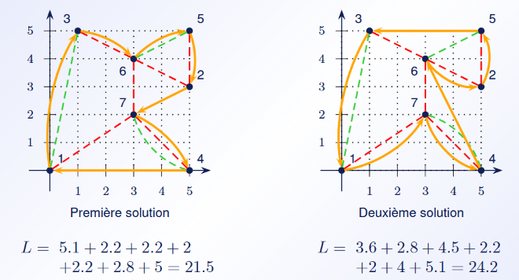
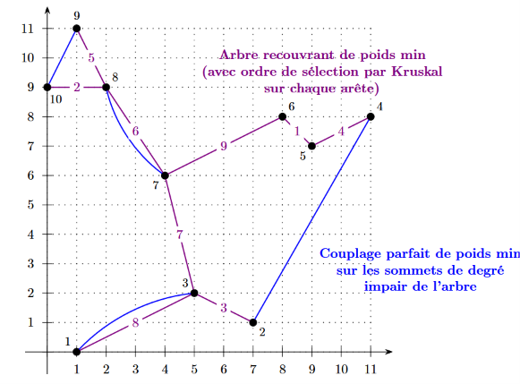
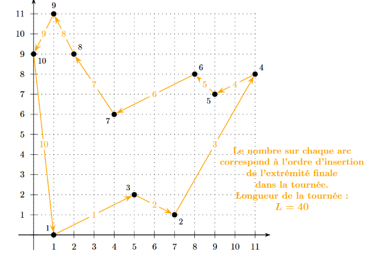
**Facteur d'approximation** = $L' \le \frac{3}{2}L*$ ou $L* = $ la longueur optimal

###### Meilleur fusion
1. choisire un sommet central
2. crée une pseudo tourné qui conciste a faire le tour des sommets en passant toujour par le sommets central
3. on fusion les arrète dans l'ordre décroissant des gains qu'elle apporte

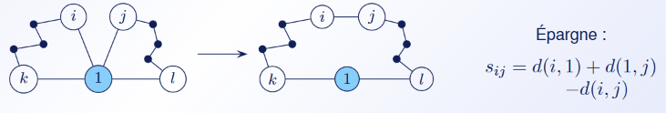
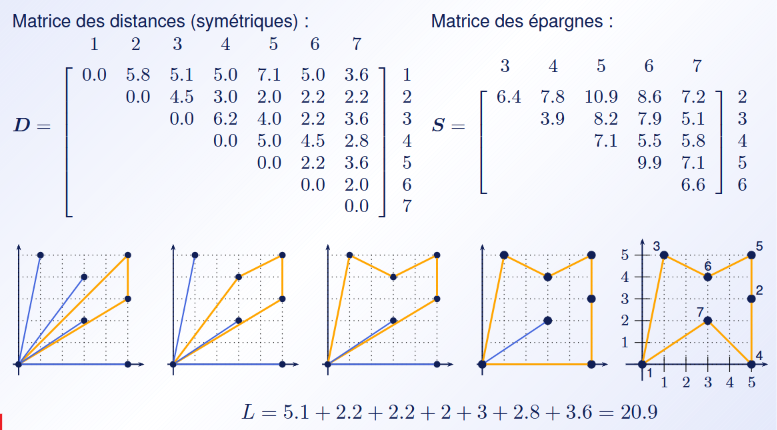

### Heuristiques d'amélioration et d'échange
en gros l'idée c'est de proposer une solution admisible → amélioré la solution localment → répéter

- modification local = *mouvement*
  - noté pour la solution $s$ avec le movement $m$ : $s \oplus m$
- nouvel solution est dite ***voisine***

###### Heuristiques k-opt
l'idée c'est de modifier une tounrée initial avec un movement
durant un movement, on peut remplacer k arêtes de la tournée
(souvant on utiliser 2-opt ou 3-opt)

- calcule du "coût" est O(1)
- modification demande une bonne strcuture, si non O(n)

#### Stats
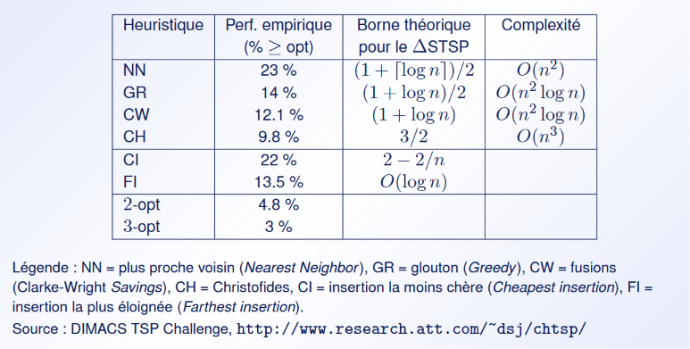

### Metaheuristique
métaheuristique = heuristique plus général mais demande d'être adapter au problème

- s'arret souvant un optimum local
- non déterministes
- pas de garantie d'optimalité

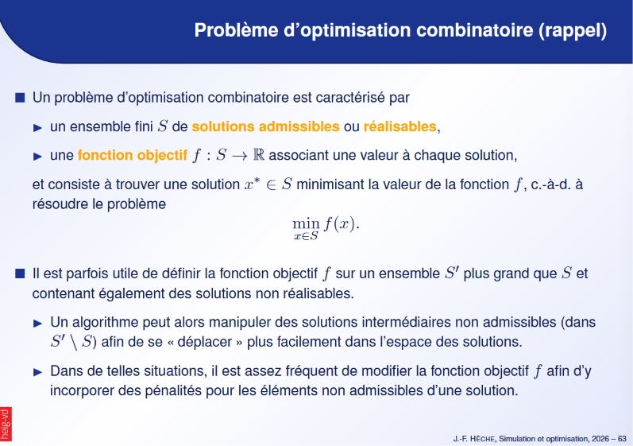

###### Notation
$\hat{x} = $minium local
$x* = $minimum gobal

###### Caracterisation
une caterisation simple est de prendre les methodes trajectoire
- Recuit simulé
- recherche avec tabou
- recherche à voisignages variable

ou les methodes basées sur la une population (ou mthodes evolutionnistes), crée plusieurs solution en meme temps → chosire la plus adapter → dervier la nouvel solution

##### recuit simulé
(ça s'appel comme ça a cause de la métalurgie, la technique du recuit)
###### Paramètre
- $x_0$ solution initial
- structure de voisinage associant a chaque solution x un esemble de solution $N(x)$
- fonction objectif $f$ a minimiser
- température initial $T_0 > 0$
- température final $T_f > 0$
- facteur de décroissance de tepérature $0<\alpha<1$

$x$ = solution courant | $x*$ = meilleur solution rencontrée pour l'instant | $T$ = température actuelle

###### infos
- plus $T$ est proche de 0, plus la probabilité d'accepeter un movement reduit
- $T_0$ dois être asser grand pour permettre une liberté de movement suffisante mais pas trop grand quand meme (si non çaa prend trop de temps)
- approche possible
  - chosire une probabilité d'acepetation inital $p$ (ex : $p = \frac{1}{3}$)
  - générer des mouvement random et calculer leur amplitude absolue moyennes
  $\Delta_m = moyen |\Delta|$
  $T_0 = -\frac{\Delta_m}{ln(p)}$
  Ainsi un mouvement dégradant a, en moyenne, une probabilité $p$ d’être accepté au début du processus d’optimisation.

###### Additional
- update de température
  - update après $n$ iteration (constant, ou dépendament de la taile $n$ du problème)
  - update après un nombre donné d'iteration sans amélioration
- critère d'arrêt
  - temps donné de calcul
  - nombre d'iteration sans amélioration de $x*$
- Réchaufement prériodique : au lieu de s'arréter quand on bouge plus, on peut tenter d'augmenter la température pour voir si ça débloque
- Choix de $\alpha$ : proche de 1, typiquement $\alpha = 0.95$
- Théorèems de convergence : si on itère assé de fois, on peut trouver la meilleur solution mais ça peut tendre ver l'infinit lol

# Simulation et Optimisation
## Programmation linéaire
l'idée est de resoudre un problème d'optimisation linaire avec un set de variable donnée, en gros, on cherche a optimizer des variable

*fallait que je le mette*

###### Exemple
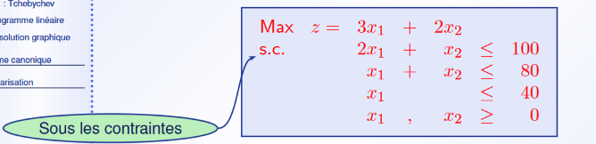

### Definition étape
1) definir des **variables de décision** → les variable qui influance le truc qu'on cherche a optimizer
2) exprimer la **fonction objectif**
  $z = \sum{C_nx_n}$
  avec $x_n = $ variable et $C_n = $constant
3) exprimer les **contraintes**
   $x_1 + x_2 > 10$ par exemple
4) resolve

## Programme linéaire (PL)
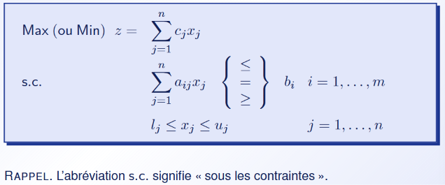
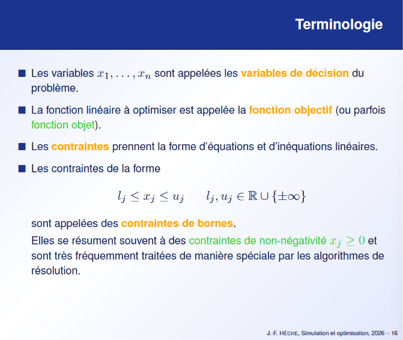
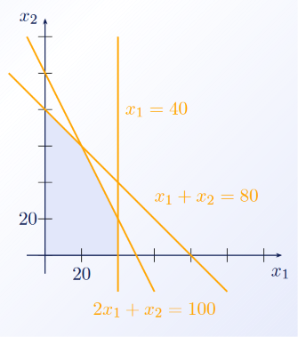
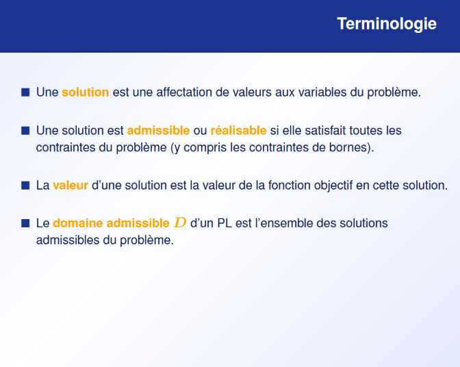
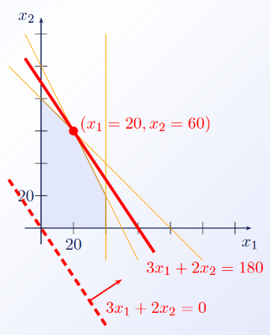
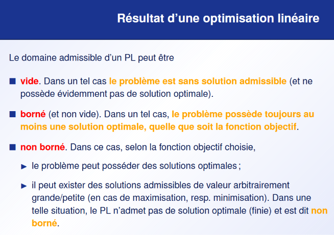

## Forme canonique d'un PL
###### Maximisation
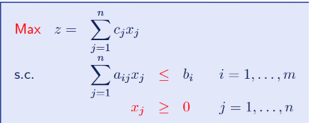
toutes les variables sont **non négatives**
toutes les autres contraintes sont du type **$\ge$**

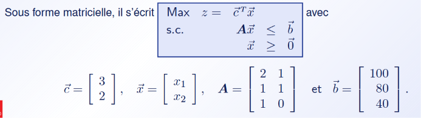

#### Régles de tranformation
###### MIN → MAX
$min f(x) = -max(-f(x))$

minimizer une function $z = (\vec{c})^{T}\vec{x} \Longrightarrow w = (-\vec{c})^{T}\vec{x}$
###### inéquation "$\ge$" → "$\le$"
$a_1x_1 + ... + a_nx_n \ge b \Longrightarrow - a_1x_1 - ... - a_nx_n \le b$

###### Équoation → inéquoation "$\le$"
$a_1x_1+ ... + = b \Longrightarrow \begin{cases}
  a_1x_1+ ... + \ge b \\
  a_1x_1+ ... + \le b
\end{cases}
$

###### inéquoation "$\le$" → Équoation
$a_1x_1 + ... + \le b \Longrightarrow \begin{cases}
  a_1x_1 + ... + s = b \\
  s \ge 0
\end{cases}$
###### Variable libre (réelle) → Variable non négative
$x\in \mathbb{R} \Longrightarrow \begin{cases}
  x=x^+ - x^- \\
  x^+, x^- \ge 0
\end{cases}$
###### Variable bornée inférieurement
$x \ge b \Longrightarrow \begin{cases}
  x=x' + b \\
  x' \ge 0
\end{cases}$

###### Exemple
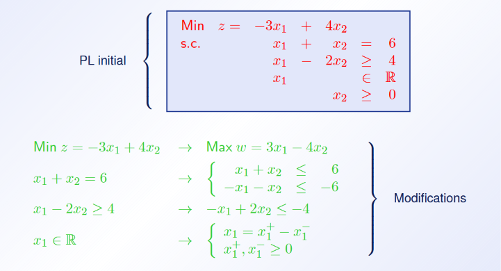
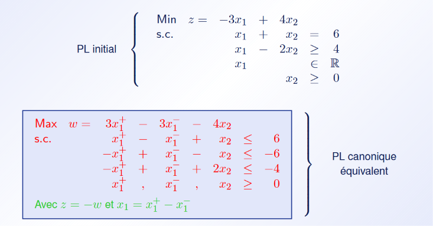

### Techniques de linearisation de base
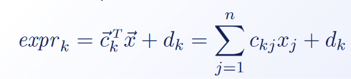
#### Linéarisation d’un min ou d’un max
$min(x_1 + x_2, x_2 + x_3, ...) \ge 5 \Longrightarrow \begin{cases}
  x_1 + x_2 \ge 5 \\
  x_2 + x_3 \ge 5 \\
  ... \ge 5
\end{cases}$

$max(x_1 + x_2, x_2 + x_3, ...) \le 5 \Longrightarrow \begin{cases}
  x_1 + x_2 \le 5 \\
  x_2 + x_3 \le 5 \\
  ... \le 5
\end{cases}$

**!! $min(...) \le exp$ ou $max(...) \ge exp$ ne sont pas linéarisables!!**

#### Linéarisation des objectifs "mini-max"
"min-max" = $Min\space z = max(...)$

- on crée $t$ pour crée
  $$
  \begin{cases}
    Min \space z = t \\
    (s.c.) \space t = max(...)
  \end{cases}
  $$
- il faut just re-écire la solution sous form d'une inéquoation
  $$\begin{cases}
    Min \space z = t \\
    (s.c.) \space t \ge max(...)
  \end{cases}
  $$
- ce qui devien
  $$\begin{cases}
    Min \space z = t \\
    (s.c.) \space t \ge ...
  \end{cases}
  $$

- $Max\space z = min(...)$
  $$\begin{cases}
    Max \space z = t \\
    (s.c.) \space t \le min(...)
  \end{cases}
  $$
  $$\begin{cases}
    Max \space z = t \\
    (s.c.) \space t \le ...
  \end{cases}
  $$

**!! "min - min" et "max - max" pas possible!!**

###### Exemple
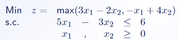
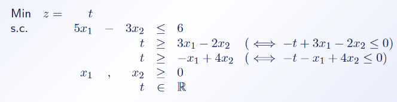

#### Linéarisation d’une valeur absolue (contrainte)
$|exp_1| \ge exp_2 $
pareille que
$-exp_2 \le exp_1 \le exp_2 \Longrightarrow \begin{cases}exp_1 \ge exp_2 \\
exp_1 \le exp_2
\end{cases}$
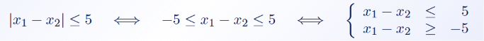
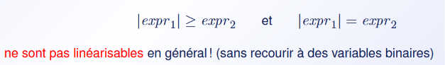
dans un cas non linelisable, comme par exemple :
$|x_1 - x_2| \le x_1 + x_2$
on peut transformer la contraint en :
$x_1 - x_2 \le x_1 + x_2$ et $x_1 - x_2\ge -x_1 - x_2$

#### Linéarisation d’une valeur absolue (objectif)
- Objectif non linéaire $Min z = |exp_1|$
- peut être re-écrit

  $$\begin{cases}
  Min\space \space \space \space z = t\\
  s.c.\\ t \ge |exp_1|\\
  t \ge 0
  \end{cases}$$

  ($x = b \Longrightarrow x \ge b$)

- ce qui devien

  $$\begin{cases}
  Min\space \space \space \space z = t\\
  s.c.\\
  -t \le exp_1 \le t\\
  t \ge 0
  \end{cases}$$
**Approximation de Tchebychev**
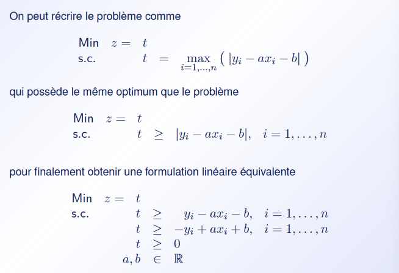

###### EXO
$\delta_i = |f(x_i) - (ax^2_i+bx_i + c)|$
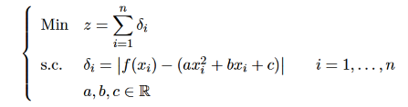
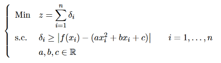
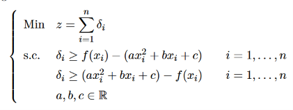

Min $z=max(\delta_i)$
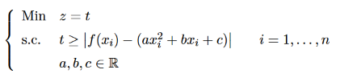
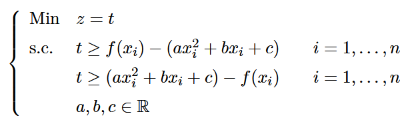

#### Mini system dans la contrainte
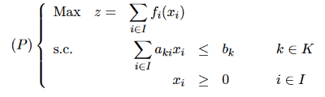
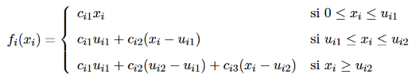

###### approche 1
on voie la fonction comme un minimum de plusieur fonction
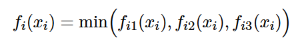
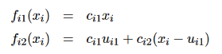
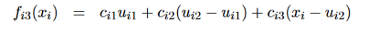
devien donc
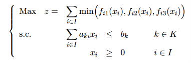
sois
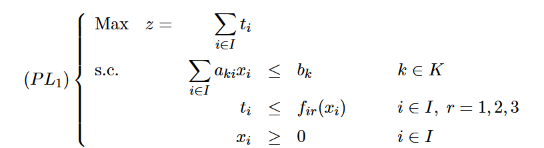
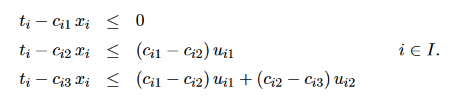

###### approche 2
on pose
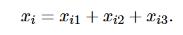
on ajout les contraintes
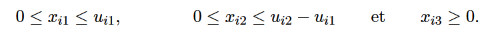
on voie donc $f(...) comme$
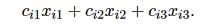
créeant
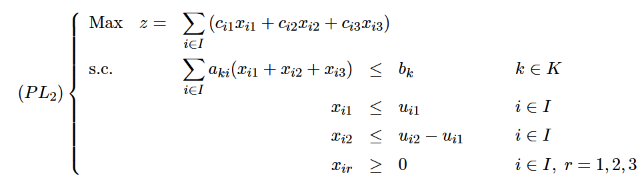

### Formulation

###### Variable de decition
  - $x_1$ = ...
  - $x_2$ = ...
  ...
###### Fonction objective
$Min\space z = ....$
*plus transformation si besoin dans le cas min-max ou inégaliter*
###### contraint
(1) $x_1 + x_2 \ge 0$
(2) ...
finaliser toujour sous form
$x_1 + x_2 \ge \space \space n$

#### Preuve pour un algo
en gros, tu veux trouver une form $L < 3C(T) < 4L*$ par exemple
bref, montré que l'apporximation est au pire aussi grand que n fois le meilleur

aussi :
- $c(T) = $ poids de l'arbre
- $L* = $ longeur de la tournée optimal
- $L = $ longeur de la tournée a analyser

#### Resoudre un programme linéaire calculs
- trouver le point opt
- voir qu'elle contraint sont appler
- resoudre le system d'op en maximisant les contraint
  $x_1\ge 1 \Longrightarrow x_1 = 1$
**contraint active a l'optimum** = contraint qui joue sur le resulta de l'optimum